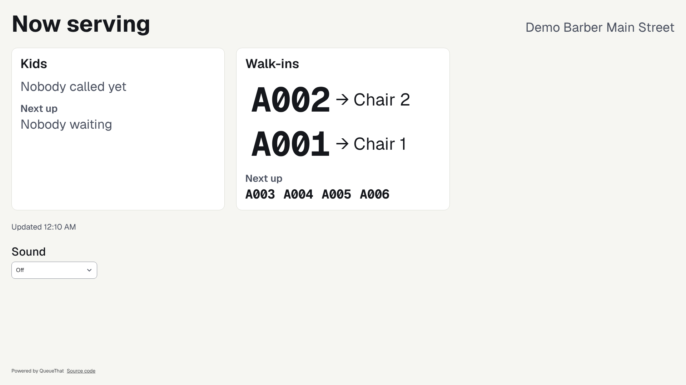
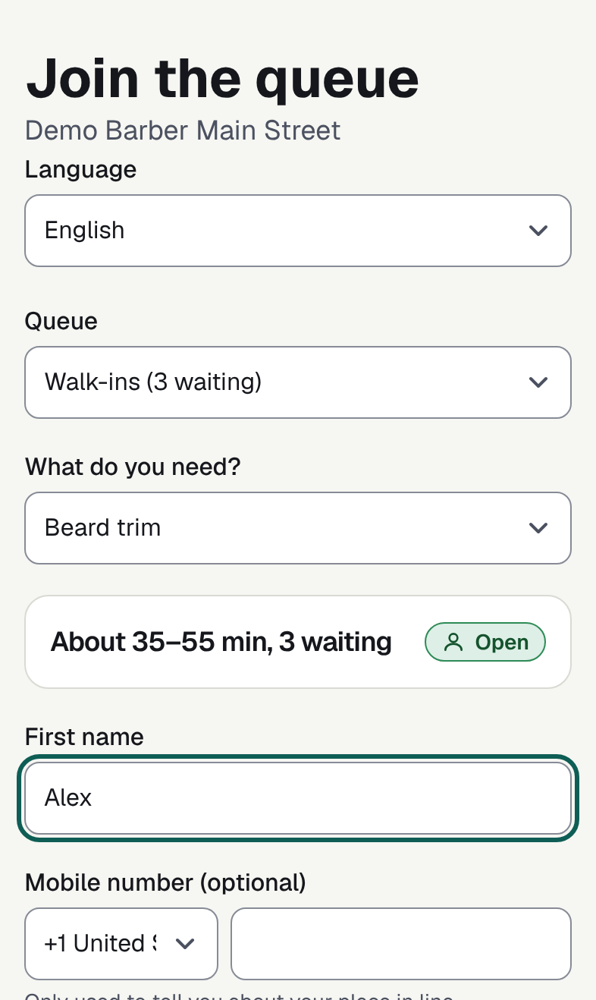
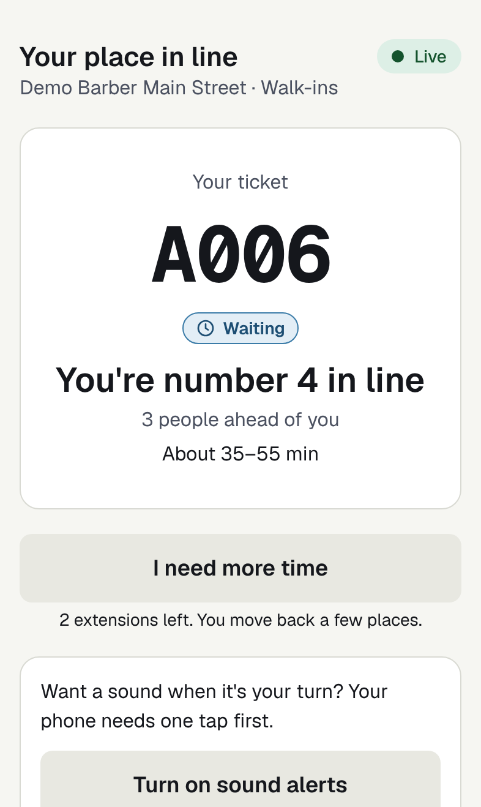
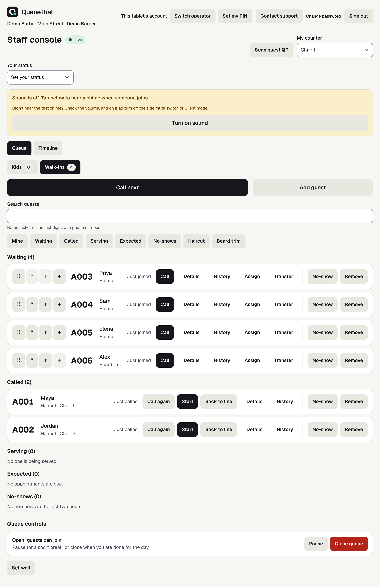
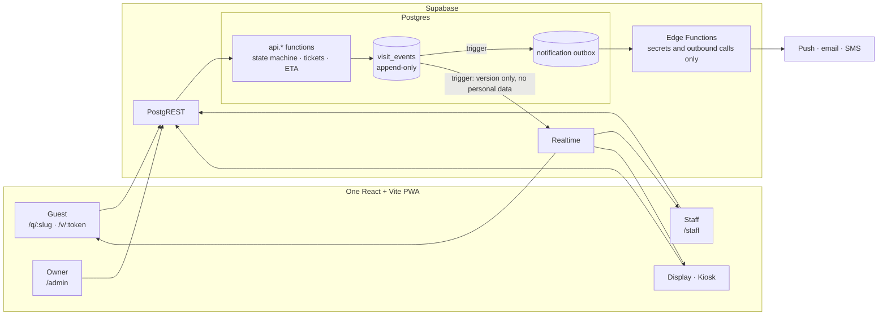

<p align="center">
  
</p>

<h1 align="center">QueueThat</h1>

<p align="center">
  Open-source walk-in queues and appointments for shops, clinics and service counters.<br>
  Guests join from a link or QR code and watch their place on their own phone. No app, no account.
</p>

<p align="center">
  <a href="https://queuethat.com">Website</a> ·
  <a href="https://app.queuethat.com">Hosted app</a> ·
  <a href="docs/selfhost/README.md">Self-hosting</a> ·
  <a href="docs/README.md">Docs</a> ·
  <a href="CONTRIBUTING.md">Contributing</a>
</p>

<p align="center">
  
</p>

QueueThat is for a business that serves people in turn: a barber, a repair counter, a clinic front
desk. It replaces the paper list and the "how long is the wait?" question with a queue that staff
run from a tablet and guests follow from wherever they are waiting.

It is licensed under AGPL-3.0. You can use the hosted service or run the whole thing yourself.

## What it looks like

|                         Guest joins from a link or QR code                          |                                                         Guest follows their place                                                          |
| :---------------------------------------------------------------------------------: | :----------------------------------------------------------------------------------------------------------------------------------------: |
|  |  |

**Staff console.** Who is waiting, who has been called, and one button to call the next guest.



All four are screenshots of the local development build with the demo data described under
[Quick start](#quick-start).

## Features

**For guests**

- Join from a link or a QR poster, or at a kiosk tablet. No sign-in and nothing to install.
- A status page with the ticket number, place in line and an estimated wait that says when it was
  last updated, rather than a countdown that pretends to know.
- Leave the queue, or undo leaving, from the same page.
- Alerts when it is their turn by web push or email; SMS, WhatsApp and Telegram when the business
  connects a provider.
- Book an appointment where the business offers them.

**For staff**

- One screen for the day: who is waiting, who has been called, who is being served.
- Call the next guest, serve, mark a no-show, move or transfer. Two tablets pressing "next" at the
  same moment call two different guests.
- Every destructive action is confirmed or can be undone.
- Add walk-ins by hand for guests without a phone.

**For owners**

- Queues, services, opening hours, counters and staff roles.
- Paired TV displays and kiosk tablets that stay signed in.
- Printable QR posters, a join widget for an existing website, branding.
- Analytics on waits, outcomes and busy hours, and data export.
- An HTTP API with keys and signed webhooks ([docs/api/v1.md](docs/api/v1.md)), plus recipes for
  [n8n](docs/integrations/n8n.md) and [Zapier](docs/integrations/zapier.md).

**Built in**

- Multi-tenant from the first table: every row belongs to an organisation and row-level security
  is on for all of them. A test matrix checks each table against each role.
- Every change to a visit is written to an append-only event log, which is what makes undo, audit
  and analytics possible.
- English throughout. Guest pages are also available in Spanish; that translation is
  machine-made and has not yet been reviewed by a native speaker.

## Hosted or self-hosted

|               | Hosted                                         | Self-hosted                                                         |
| ------------- | ---------------------------------------------- | ------------------------------------------------------------------- |
| Where         | [app.queuethat.com](https://app.queuethat.com) | Your own Linux server with Docker                                   |
| Who runs it   | The QueueThat maintainers                      | You: updates, backups, email delivery                               |
| Code          | This repository                                | This repository                                                     |
| Email and SMS | Set up in the app                              | Bring your own SMTP account and, for SMS, your own provider account |
| Start here    | [queuethat.com](https://queuethat.com)         | [docs/selfhost/README.md](docs/selfhost/README.md)                  |

## Quick start

This runs the app on your machine with demo data. You need Node 24, pnpm 10 and Docker.

```sh
git clone https://github.com/queuethat/queuethat-oss.git
cd queuethat-oss
pnpm i
pnpm db:start     # local Supabase in Docker; the first run pulls several images
pnpm db:reset     # applies the migrations and loads the demo shop
cp apps/web/.env.example apps/web/.env.local
pnpm exec supabase status -o env | sed -n 's/^ANON_KEY="\(.*\)"/VITE_SUPABASE_ANON_KEY=\1/p' >> apps/web/.env.local
pnpm dev          # http://localhost:5173
```

Then:

- Open <http://localhost:5173/q/demo-barber> and join the queue as a guest.
- Open <http://localhost:5173/staff> in another window and sign in as `staff@demo.test` with the
  password `password123`. Call the guest you just added.
- Sign in as `owner@demo.test` (same password) to see the admin console at `/admin`.

These logins exist only in the local demo seed.

To run it for a real business, follow the [self-hosting guide](docs/selfhost/README.md): a setup
script generates the secrets and `docker compose up` starts a pinned Supabase stack, the web app
and Caddy on one server.

## How it works

Postgres is the application. There is no application server: the browser calls Postgres functions
through Supabase, and the database owns the state machine, the ticket numbers and the wait
estimate. The web app renders what the database returns.



- **Guests never touch a table.** They hold a random link token, stored only as a hash, and may
  call a short allowlist of functions ([supabase/security-definer-allowlist.txt](supabase/security-definer-allowlist.txt)).
- **Staff read tables through row-level security** and change visits only through `api.*`
  functions, so a visit cannot change without an event being written.
- **Live updates carry no personal data.** A broadcast says "something changed"; each client then
  fetches its own view.
- **Edge Functions exist only for what a database should not do**: hold provider secrets, send
  messages, verify a CAPTCHA.

More in the [architecture overview](docs/architecture/README.md) and the original
[technical design](docs/architecture/technical-design.md).

## Project layout

```
apps/web/             the single-page app for every surface (React, Vite, TanStack Router)
packages/domain/      pure TypeScript: formatting, error codes
packages/ui/          the UI kit; the only place components are defined
packages/providers/   notification, payment and integration adapters
packages/db-types/    types generated from the database
supabase/migrations/  the schema and every api.* function
supabase/tests/       pgTAP tests, including the row-level security matrix
supabase/functions/   Edge Functions (Deno)
deploy/selfhost/      Docker Compose stack, setup script, Caddy config
tests/                Playwright end-to-end and concurrency tests
docs/                 architecture, self-hosting, operations, API
```

## Contributing

Bug reports, fixes and translations are welcome. [CONTRIBUTING.md](CONTRIBUTING.md) covers setup,
the checks a pull request must pass (`pnpm ci:local` runs all of them on your machine) and the
rules for database changes. Please open an issue before starting on a feature.

## Security

Please report vulnerabilities privately, not in a public issue. [SECURITY.md](SECURITY.md) says how
and what is in scope.

## Licence

[GNU Affero General Public License v3.0](LICENSE). If you run a modified version as a network
service, the AGPL requires you to offer your users its source. The app links to its source from
every guest page; a fork changes that link in one place, `packages/domain/src/source.ts`.

The bundled Geist and Geist Mono fonts are under the
[SIL Open Font License](apps/web/public/fonts/GEIST-OFL-LICENSE.txt).
