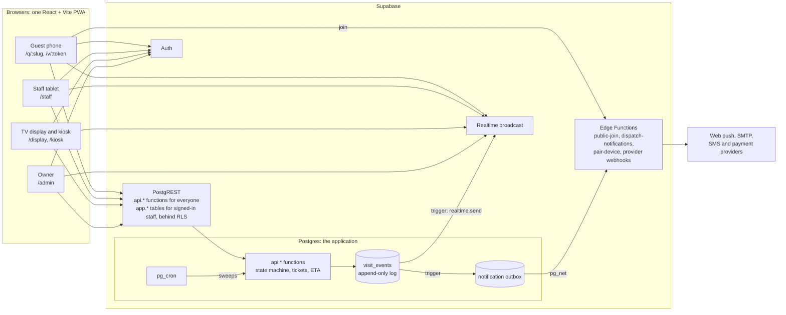

# Architecture

QueueThat has no application server. The browser talks to Supabase (Postgres, PostgREST, Auth,
Realtime), and every state change is a Postgres function in the `api` schema. Edge Functions exist
only where the database cannot do the job: holding secrets, calling outside services, checking a
CAPTCHA.

This page is the working overview: the map, the modules, and the invariants a change must keep.
[technical-design.md](technical-design.md) is the original decision record and explains why each
choice was made; the ADRs in [adr/](adr/) record later decisions.

## System context

## Repository map

| Path | What it is |
| --- | --- |
| `apps/web` | One SPA for every surface: `/q/:slug` join, `/v/:token` status, `/staff`, `/admin`, `/display`, `/kiosk`, `/auth`, `/dev/ui`. See [apps/web/README.md](../../apps/web/README.md). |
| `packages/domain` | Pure TypeScript: formatting, error codes. |
| `packages/ui` | The only UI kit. Features never use raw buttons or inputs. |
| `packages/providers` | `NotificationChannel` and payment provider interfaces and adapters. |
| `packages/db-types` | Types generated from the database. Never edited by hand. |
| `supabase/` | Migrations, pgTAP tests, seeds, Edge Functions. See [supabase/README.md](../../supabase/README.md). |
| `deploy/selfhost` | The Docker Compose stack for self-hosting. See [docs/selfhost](../selfhost/README.md). |
| `tests/` | Playwright end-to-end tests, concurrency tests, shared fixtures. |

Database schemas: `app` holds base tables (signed-in users only, behind RLS), `api` holds the
functions, enums and return types that clients call, `private` holds helpers and `ops` holds cron
jobs. Neither `private` nor `ops` is exposed.

## Deep modules

The design follows _A Philosophy of Software Design_: a few modules with small interfaces that hide
a lot, and each rule owned by exactly one of them.

| Module | Interface | Hides |
| --- | --- | --- |
| Visit engine | `api.join_queue`, `transition_visit`, `call_next`, `undo_event`, `guest_act`, `get_visit_status`; rows carry `allowed_actions` | numbering, service day, accepting predicate, state machine, locking, idempotency, events |
| ETA | `private.visit_eta` returns `(eta_state, eta_low, eta_high)`; `formatEta` only renders | formula, degradation rules |
| Live data | `useLiveQuery`, `useConnectionState` | channels, jitter, polling, reconnect |
| Notifications | enqueue is automatic; providers implement `NotificationChannel.send` | rules, consent, suppression, retries |
| Tenancy | RLS plus `private.has_role` and `private.is_device` | memberships, devices, role ladder |
| UI kit | `packages/ui` | destructive-action safety, hit targets, tokens, accessibility |

## Invariants

Code comments, tests and reviews cite these by number.

- **I-1** Visits are never hard-deleted. Every visit change writes a `visit_events` row (trigger-enforced).
- **I-2** Visit and queue-state mutations go only through `api.*` functions. No client writes `app.visits`.
- **I-3** Every tenant table has `org_id NOT NULL`, RLS on, per-command policies, and an entry in
  `supabase/tests/rls/matrix.yaml`. Cross-tenant access is always denied.
- **I-4** `anon` has no table access. It may execute exactly the guest functions marked `anon` in
  `supabase/security-definer-allowlist.txt`. Changing that list needs a security review.
- **I-5** Realtime payloads carry no personal data. Public topics are `qpulse:{pulse_id}` with
  `{version, now_serving}` only.
- **I-6** `timestamptz` only. Local dates (service day, hours) are computed in SQL from the location's time zone.
- **I-7** Guests never sign in. They hold a link token stored only as sha256. `join_queue` re-derives it
  (HMAC with the Vault secret `guest_token_secret`) only for the device that joined; it is never stored.
- **I-8** The accepting predicate (is this queue taking guests right now) is enforced inside the
  database for every entry point.
- **I-9** Destructive actions use `ConfirmDestructive` or offer undo. Primary actions are at least 48 px.
- **I-10** `/q`, `/v`, `/b`, `/a`, `/display` and `/kiosk` URLs are frozen: they are printed on posters
  and bookmarked on devices.
- **I-11** Outbound messages go only through a `NotificationChannel` via the outbox. Nothing else sends.
- **I-12** Migrations are expand/contract, immutable once merged, one per pull request, and sort last.
  Generated files are regenerated, never hand-merged.
- **I-13** Every user-facing string goes through `t()`. Contact data never appears in guest responses or logs.

## Interface rules

1. Extend a deep interface before adding an entry point: append defaulted parameters to
   `join_queue`, add `api.guest_action` or `api.visit_action` values. A pull request that adds a
   public RPC must say why an existing one could not be extended.
2. One owner per rule. The database owns the state machine and the ETA and returns
   `allowed_actions`, `guest_actions` and `eta_state`. Clients render them and never re-derive them.
3. No pass-through layers. An Edge Function exists only when it adds a capability (secrets,
   outbound I/O, CAPTCHA). The web app has one query hook per RPC in `features/<area>/api.ts`.
4. Define errors out of existence: repeated joins, leaves and rollovers are no-ops, not errors.
5. Pull complexity down into triggers and definer functions so callers cannot forget an invariant.
6. Interface comment first: `COMMENT ON FUNCTION` (guarantees and errors, not how) and JSDoc on exports.
7. A change to an interface lists two alternatives and why one won.
8. A change owns one module end to end where possible.

The signatures of the original `api.*` functions are fixed. Their bodies are replaced with
`create or replace`; a signature or return type does not change in a feature pull request, because
old PWA bundles on TVs and kiosks keep calling them for weeks.

## Never

- Disable RLS, grant table privileges to `anon`, or write `SECURITY DEFINER` without `set search_path = ''`.
- Edit a merged migration.
- Skip or weaken a test (`.skip`, `.only`, deleting pgTAP assertions) to get a green run.
- Put the service-role key or any secret in `apps/web` or the bundle.
- Re-implement state-machine or ETA rules in TypeScript.
- Use raw `<button>` or inputs in `apps/web/src/features/**` (use `packages/ui`), or raw JSX strings (use `t()`).

## A note on references in the code

Comments and commit messages cite feature ids such as `J-1` or `2P-APT2` and issue numbers such as
`#398`. The feature ids are defined in [feature-spec.md](../research/feature-spec.md); the issue
numbers refer to the private tracker used before this repository was published and do not
match issues here. Migration comments that mention `CLAUDE.md` refer to the rules now on this page
(migrations are immutable, so those comments stay as written).
