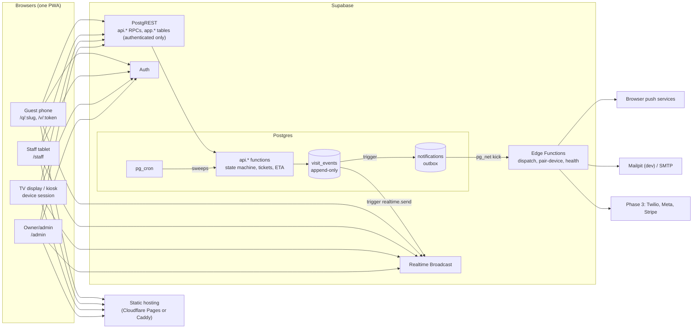

# Technical design: open-source queue management

Status: accepted · Date: 2026-10-25

> **This is the original decision record, kept as written.** It explains why the architecture is
> what it is. Sections 9 to 12 describe how the first build was planned and staffed (phases,
> tickets, automated contributors) and are history, not instructions. For the current overview and
> the rules a change must keep, read [README.md](README.md). Where the two differ, the code and
> the overview win.

Inputs: a competitive analysis (not published), the [feature spec](../research/feature-spec.md), and four role reviews (architecture, DevOps, security/compliance, staff engineering). The security and compliance review is kept at [docs/compliance/security-review.md](../compliance/security-review.md) because the compliance gate tests read it; the other three were planning input and have been removed. Where the reviews disagreed, this document makes the call and says why.

---

## 1. Executive summary

We are building a self-hostable, open-source alternative to Waitwhile: walk-in queues, a live guest status page, a staff console, a waiting-room display and, later, appointments and paid messaging. The research says the market's complaints are about care, not technology: lost entries, wrong wait times, silent alerts, accidental dismissals, metering. The architecture is therefore built around one property: **no guest is ever lost, and every change is explainable after the fact.**

The decisions that matter:

1. **Postgres is the application.** Every state change is a Postgres function (RPC) on Supabase. There is no app server. Edge Functions only talk to the outside world (push, email, later SMS and webhooks).
2. **One append-only event log** (`visit_events`) drives audit, undo, realtime updates, the notification outbox and analytics. A trigger makes it impossible to change a visit without writing an event.
3. **Guests are anonymous and never touch tables.** They hold a 128-bit link token (stored hashed) and can call only the guest functions marked `anon` in `supabase/security-definer-allowlist.txt` (`api.guest_grant_consent` is token-authorised like `guest_act`). Live updates reach them through a PII-free broadcast "pulse" followed by a refetch, not through Supabase's row-change feed, which cannot authorize anonymous users safely.
4. **No midnight reset job.** Ticket numbers are keyed by a per-location "service day", so they restart on their own and late-night or cross-midnight hours just work.
5. **One React + Vite PWA** for guest, staff, display, kiosk and admin, deployed as static files. Local dev on the Supabase CLI in Docker; pilot on Supabase Cloud free + Cloudflare Pages; self-host via a pinned docker compose that CI boots nightly.
6. **Autonomous agents build it, so CI is the reviewer.** CI, the RLS test harness, contract stubs and agent rules land before any feature ticket is opened to agents.

What the plan got wrong, in short (details in section 9):

- **Phase 1 can't run a real shop as specified.** It exposes an anonymous write endpoint on the internet, yet rate limiting, device auth, display privacy, the audit log, CI, backups and DST tests are all P1 or later. We move about 15 rows up and about 6 down (section 9.1).
- **Four P0 features depend on P1/P2 features** (display needs counters and device tokens; ETA needs a count of active staff; undo needs the event log).
- **iPhone guests won't get "you're up" alerts.** Web push on iOS needs the PWA added to the home screen, which walk-ins won't do, and Safari suspends background tabs. This is the biggest product risk and needs a decision before the pilot (section 10, D1).
- **Detailed tickets for all 199 features now carries a staleness risk.** Later-phase tickets will reference code that doesn't exist yet. We create them anyway (The maintainer's decision) but park them as `status:icebox` with a mandatory re-validation step (section 11.4).

## 2. Goals, non-goals, constraints

**Goals (phase 1 exit):** one real small business runs a full day on it, guests joining from their own phones over mobile data, with nothing lost and every action traceable.

**Non-goals:** native apps; hardware; HIPAA/SOC 2; Google Maps join (needs partner approval); ML wait-time prediction; any paid service before phase 3.

**Constraints:** solo side project; free tier and local-first; Supabase in Docker for local development; paid integrations (SMS, WhatsApp, email delivery, Stripe) built behind interfaces with local stubs and switched on in phase 3; work done largely by autonomous coding agents picking up GitHub issues.

**Quality bar (non-negotiable invariants):**

| Invariant | Enforced by |
|---|---|
| A visit is never hard-deleted and never changes state without an event | Trigger on `visits`; `DELETE` revoked; pgTAP |
| Illegal state transitions are impossible from any caller | `visit_transitions` table + BEFORE UPDATE trigger |
| No tenant can read or write another tenant's rows | RLS + structural and matrix pgTAP tests in CI |
| Anonymous users have no table access | `anon` has no `USAGE` on the table schema; CI asserts grants |
| Two staff pressing "call next" never call the same guest | `FOR UPDATE SKIP LOCKED`; concurrency test |
| A double-tap or retry never creates a duplicate | Idempotency key on every mutating RPC |
| No outbound message bypasses the provider interface, consent and suppression checks | `notifications` outbox; dispatcher is the only sender |

## 3. Architecture

### 3.1 Stack (one choice each)

| Concern | Choice | Why |
|---|---|---|
| Frontend | React + Vite + TypeScript SPA, TanStack Router (file-based) + TanStack Query, Tailwind + shadcn/ui | Agents know it best; static build means no SSR server to run; file-based routes mean new screens are new files, not merge conflicts |
| PWA | `vite-plugin-pwa` (Workbox) with a custom service worker for push | Offline shell, install, push handler in one place |
| Monorepo | pnpm workspaces, no Turborepo | Small repo; fewer moving parts |
| Lint/format | ESLint (flat config, react-hooks rules) + Prettier; `squawk` for migration lint | react-hooks rules catch real agent bugs; Biome lacks them |
| Backend | Supabase: Postgres, Auth (GoTrue), PostgREST, Realtime (Broadcast), Storage, Edge Functions (Deno) | Chosen in research; all pieces run locally in Docker |
| Business logic | PL/pgSQL `SECURITY DEFINER` functions in schema `api`, `SET search_path = ''` | Transactions, row locks and RLS live next to the data; testable with pgTAP |
| Jobs | `pg_cron` for sweeps; `pg_net` to kick the dispatcher | Ships with Supabase; no Redis or worker process |
| Outbox | Plain `notifications` table claimed with `FOR UPDATE SKIP LOCKED` | Doubles as delivery log (N-12) and cost ledger (V-5) |
| Types | `supabase gen types` committed to `packages/db-types`; RPCs return composite types, never bare `json` | Typed client calls for free; CI fails on drift |
| Tests | pgTAP (`supabase test db`), Vitest, Vitest + `postgres.js` for real concurrency races, Playwright (multi-context: phone, tablet, TV) | The product's core claim is a multi-device property |
| Errors/uptime | Sentry SDK with env DSN (Sentry or GlitchTip free); UptimeRobot; Healthchecks.io | All free; P-8 is not "Paid" |
| License | AGPL-3.0 with DCO sign-off | Stops a competitor hosting it without sharing changes (Cal.com precedent). Use a CLA instead only if the maintainer may ever sell commercial licences (decision D4) |

### 3.2 Repository layout

```
apps/web/                 # single SPA: /q/:slug (join), /v/:token (status), /staff, /display, /kiosk, /admin, /dev/ui
packages/db-types/        # generated, never hand-edited (linguist-generated)
packages/domain/          # pure TS: phone normalisation, ETA formatting, ticket display, error-code map
packages/providers/       # NotificationChannel + PaymentProvider interfaces and local impls; Deno- and browser-safe ESM
packages/ui/              # design system: BigButton, ConfirmDestructive, UndoToast, PhoneInput, StatusBadge
supabase/migrations/      # ordered SQL, immutable once merged
supabase/seeds/           # numbered files, deterministic UUIDs
supabase/tests/           # pgTAP: structure/, rls/ (matrix.yaml), state_machine/, eta/, rollover/
supabase/functions/       # dispatch-notifications, pair-device, public-join (P1), health, provider webhooks (phase 3)
tests/concurrency/        # Vitest races against the local DB
tests/e2e/                # Playwright
deploy/selfhost/          # compose, setup.sh, Caddyfile, cloudflared profile, backup service
deploy/load/              # k6 scripts
docs/                     # research, architecture, ops runbooks
CONTRIBUTING.md           # how to work on the project; rules live in docs/architecture/README.md
```

### 3.3 System context



### 3.4 Key flows

**Guest join.** The browser generates an idempotency key per queue (kept in localStorage) and calls `api.join_queue`. In one transaction the function: checks `queue_is_accepting()` (manual state, business hours, capacity; this single predicate implements Q-17 for every entry point), returns the existing visit if the key was already used, takes the next ticket number from `ticket_counters`, computes `sort_key`, inserts the visit with `guest_token_hash = sha256(token)`, and returns `{token, display_ticket, status}`. Triggers write the `joined` event and enqueue notifications. The client redirects to `/v/:token`. Client-supplied priority, status, org or ticket values are ignored.

**Staff "call next".** `api.call_next(queue, counter, key)` selects the first waiting visit by `sort_key` with `FOR UPDATE SKIP LOCKED`, moves it to `called`, sets the counter and returns it. Two tablets pressing together call two different guests; a double-tap calls one.

**Realtime.** An AFTER INSERT trigger on `visit_events` calls `realtime.send` twice: once to the private topic `loc:{location_id}` (staff and devices, authorized by RLS on `realtime.messages`) and once to the public topic `qpulse:{pulse_id}`, where `pulse_id` is a random per-queue UUID that is not the queue id. The pulse carries only `{version, now_serving}`. Guests refetch `api.get_visit_status(token)` after 0–1.5 s of random jitter, and every client also polls every 30 s and on `visibilitychange` because iOS kills background sockets. The token is never a topic name. Nothing personal ever goes over a public channel.

**Notifications.** The event trigger evaluates notification rules and inserts `notifications` rows in the same transaction (dedupe key = event + channel + recipient). A statement trigger kicks the `dispatch-notifications` Edge Function through `pg_net`; `pg_cron` re-kicks every 15 s for retries. The dispatcher claims a batch with a lease, re-checks relevance (drops "almost up" if the guest was already called; drops "called" if the call was undone), checks consent, suppression and quiet hours, sends through the provider interface, and records the result, provider id and cost. Delivery is at least once with bounded duplicates; six failed attempts mark a row `dead`, which staff can see.

**Service day and rollover.** `service_day = (now() at time zone location.tz - location.day_boundary)::date`, with a default boundary of 04:00 so a bar open until 2 a.m. stays on one day. Ticket counters are keyed by `(queue, prefix, service_day)` and need no reset. A `pg_cron` tick every 5 minutes expires leftover non-terminal visits for any location whose service day has changed. It is idempotent and safe to run late.

### 3.5 Module map and interface rules (APOSD)

The design follows *A Philosophy of Software Design*: a few deep modules with small interfaces that hide a lot, each piece of knowledge owned by exactly one of them. Tickets name the module they change (section 11.4), and reviewers check the rules below.

| Module | Interface (what callers see) | What it hides |
|---|---|---|
| Visit engine | `api.join_queue`, `api.transition_visit`, `api.call_next`, `api.undo_event`, `api.guest_act`, `api.get_visit_status`; rows carry `allowed_actions` | Ticket numbering, service day, accepting predicate, state machine, locking, idempotency, event writing, audit |
| ETA | `private.visit_eta(visit)` returning `(eta_state, eta_low, eta_high)`; `formatEta` in `packages/domain` only renders it | Formula, server count, degradation rules, rounding |
| Live data | `useLiveQuery({topic, queryKey, queryFn})`, `useConnectionState()` | Channels, topics, jitter, polling fallback, reconnect, stale-version dropping |
| Notifications | Enqueue is automatic from events; providers implement `NotificationChannel.send` | Rules, dedupe, consent, suppression, quiet hours, leases, retries, relevance, cost |
| Tenancy and auth | RLS plus `private.has_role(...)`; device pairing code to session | Memberships, device claims, role ladder, revocation |
| Device session | `/display` and `/kiosk` pair once and stay current | Auth user creation, refresh, heartbeat, forced updates |
| UI kit | `packages/ui` components | Destructive-action safety, hit targets, tokens, accessibility |

Interface rules:

1. **Extend a deep interface before adding an entry point.** `join_queue` grows by appending defaulted parameters (answers, group key, on-site code, arrive-after, location routing) in a drop-and-recreate migration; guest actions grow as `api.guest_action` enum values. A PR adding a new public RPC must say why an existing one can't be extended.
2. **One owner per piece of knowledge.** The database owns the state machine and the ETA rules and returns decisions (`allowed_actions`, `guest_actions`, `eta_state`); clients render them and never re-derive them. No rule exists in both SQL and TS.
3. **No pass-through layers.** An Edge Function exists only when it adds a capability the database can't have (secrets, outbound I/O, CAPTCHA). The web app has one query hook per RPC, not a wrapper per call site.
4. **Define errors out of existence.** Joining twice returns the same visit, leaving twice returns `cancelled`, rollover twice changes nothing, service-day keys remove the reset job. Prefer operations that are safe to repeat over error codes callers must handle.
5. **Pull complexity down.** Invariants are enforced inside the module (triggers, definer functions, the dispatcher) so callers can't forget them.
6. **Interface comment first.** Every `api.*` function gets `COMMENT ON FUNCTION` (what it guarantees and which errors it raises, not how) before its body; exported TS functions get the same in JSDoc.
7. **Design it twice for interface changes.** A ticket that adds or extends an interface lists two alternatives considered and why one was chosen.
8. **Slice by module where possible.** A ticket should own one module's change end to end. The current backlog splits many features into an RPC ticket and a screen ticket against a fixed contract; that is acceptable only because the contract is fixed first, and new tickets should prefer one module per ticket.

`api.staff_add_visit` stays a separate entry point because staff joins carry different trust (no CAPTCHA, block-list override, consent attestation); it is a thin wrapper over the same `private.join_core`, which is the deep module.

## 4. Data model

All base tables live in schema `app`. PostgREST exposes `app` to `authenticated` only (anon has no `USAGE` on it) and exposes `api` (RPCs) to both. This makes "forgot to add RLS" non-fatal for anonymous users and turns the public API into a deliberate surface. Every tenant table carries `org_id NOT NULL`; child tables use composite foreign keys such as `(org_id, queue_id) → queues(org_id, id)` so a row can never point across tenants.

| Table | Key columns | Phase |
|---|---|---|
| `organizations` | id, name, slug, logo_path, default_locale, legal_name, postal_address, support_contact | 1 |
| `memberships` | org_id, user_id, role (owner/admin/manager/staff), location_ids (null = all) | 1 |
| `devices` | id, org_id, location_id, kind (display/kiosk), auth_user_id, scopes, last_seen_at, app_version, revoked_at | 1 |
| `locations` | id, org_id, slug (immutable once printed), tz, day_boundary, last_rollover_day, address, contact, display_names_enabled (default false) | 1 |
| `business_hours`, `hours_exceptions` | location_id, weekday, opens, closes (closes < opens crosses midnight); exceptions by date | 1 / P1 |
| `queues` | id, org_id, location_id, name, ticket_prefix, manual_state (open/paused/closed), pulse_id, servers_on_duty, capacity, show_eta, version | 1 |
| `services` | id, org_id, queue_id, name, expected_minutes, color, active | 1 |
| `counters` | id, org_id, location_id, label | 1 |
| `ticket_counters` | queue_id, prefix, service_day, last_value; PK on all three except last_value | 1 |
| `visits` | id, org_id, location_id, queue_id, service_id, service_day, ticket_prefix, ticket_number, display_ticket, status, sort_key, party_size, guest_name, guest_id (nullable), contact_id (nullable), guest_token_hash, source, counter_id, assigned_staff_id, call_count, eta_quoted_low/high, joined_at, called_at, serving_at, finished_at, version, idempotency_key | 1 |
| `visit_events` | id, org_id, visit_id, type, from_status, to_status, actor_kind (staff/guest/device/system), actor_id, reason, payload, undone_by_event_id, occurred_at | 1 |
| `audit_log` | org_id, actor, role, action, table_name, row_id, before, after, at; generic trigger on config tables | 1 |
| `idempotency_keys` | actor_id, key, rpc, response, created_at (purged after 48 h) | 1 |
| `push_subscriptions` | org_id, visit_id, endpoint, p256dh, auth | 1 |
| `guests`, `guest_contacts` | contacts: channel, value_e164, country_code, verified_at, created_source | 1 (schema), P1 (CRM UI) |
| `consents` | contact_id, channel, purpose (transactional/marketing), status, captured_at, source, consent_text_version, consent_text_hash, captured_by_user_id, revoked_at, revoked_via | 1 (schema) |
| `suppressions` | org_id, channel, value_e164, reason | 1 (schema) |
| `notifications` | org_id, visit_id, event_id, channel, recipient_ref, template_key, template_version, category, vars, dedupe_key, consent_id, status, attempts, next_attempt_at, locked_until, provider, provider_message_id, error_code, segments, cost_micros, quiet_hours_deferred | 1 |
| `notification_templates` | org_id (null = default), queue_id, trigger, channel, locale, category, body | 1 |
| `inbound_messages`, `dev_inbox` | raw payload, signature_verified, matched contact / console provider output | 1 (dev_inbox), 3 |

The messaging-compliance tables exist from phase 1 so phase 3 swaps a provider, not a schema. The console provider runs the same consent and suppression checks the real ones will.

### 4.1 Visit state machine

States: `expected` (reserved for appointments), `waiting`, `called`, `serving`, `served`, `no_show`, `cancelled` (by guest), `removed` (by staff, with reason), `expired` (by system). "Transferred", "snoozed" and "on my way" are **events, not states**; a transfer changes `queue_id`, recomputes `sort_key` and stays `waiting`. The spec's "transferred" status would break position, ETA and analytics.

| From → To | Action | Actor |
|---|---|---|
| waiting → called | call / call_next | staff |
| called → called | recall (call_count + 1) | staff |
| called → serving | start | staff |
| called → waiting | requeue (keep place) | staff |
| serving → served | complete | staff |
| waiting, called → no_show | no-show (manual in P0, auto in P1) | staff, system |
| waiting, called → cancelled | leave | guest, staff on behalf |
| waiting, called → removed | remove with reason, confirmed | staff |
| non-terminal → expired | rollover | system |
| no_show → waiting | reinstate | staff |
| expected → waiting / cancelled / no_show | appointment check-in (P1) | staff, guest |
| undo | inverse of the last event, if visit.version unchanged and event < 10 min old | staff |

Ordering: `sort_key bigint`, spaced on insert; reorder takes the midpoint and renumbers the queue in the same transaction when there is no gap. Position is always computed, never stored. Priority classes (Q-10) become an offset at insert, so manual reorder always wins.

Concurrency: mutating RPCs take `p_idempotency_key`; visit transitions also take `p_expected_version` and raise `stale_visit` on mismatch so the UI refetches. This also makes the later offline action queue (S-12) cheap.

## 5. Security model

**Roles.** `owner`, `admin`, `manager`, `staff` via `memberships`; `display` and `kiosk` devices; `anon` guests holding a visit token. Role checks happen in the database, not the UI.

**Guests.** `anon` gets `EXECUTE` on exactly: `get_location_public`, `join_queue`, `get_visit_status`, `guest_act`, `guest_register_push`. Later phases add guest functions (booking, consent, preferences) only through a `security-review` PR that updates the allowlist and the anon-grants test. The visit token is 32 random bytes (base64url), stored only as SHA-256, absent from logs, sent with `Referrer-Policy: no-referrer`, and invalid 12 h after the visit ends. Unknown and expired tokens return the same 404. The status response never includes contact data. From P1, the public join moves behind a `public-join` Edge Function (CAPTCHA + rate limits) and `anon` loses direct `EXECUTE` on `join_queue`.

**Devices.** Each display or kiosk is a real Supabase Auth user created by the `pair-device` Edge Function from a 6-digit, 10-minute pairing code shown in admin. Claims live in `app_metadata` (never `user_metadata`, which users can edit): `{kind, org_id, location_id, scopes}`. Revocation bans the user and sets `revoked_at`. Display reads only a sanitized snapshot RPC; kiosk can only join for its location. We don't hand-mint long-lived JWTs because we would own expiry, rotation and revocation forever.

**RLS rules, encoded as CI tests rather than prose.**

- Structural tests fail the build if any table in an exposed schema has RLS off or zero policies; any `SECURITY DEFINER` function lacks a fixed `search_path` or is executable by `anon`/`PUBLIC` without being on `supabase/security-definer-allowlist.txt`; any view lacks `security_invoker = true`; any materialized view sits in an exposed schema; `anon` holds any table privilege.
- A behavioural matrix (`supabase/tests/rls/matrix.yaml`): two orgs × {anon, guest token, owner, admin, manager, staff, display, kiosk} × every table × {select, insert, update, delete}. A new table with no matrix entry fails CI.
- Every `INSERT`/`UPDATE` policy has `WITH CHECK` pinning `org_id`.
- Policies call one helper, `private.has_role(org_id, location_id, min_role)`, wrapped as `(select ...)` for plan caching.

**Abuse.** P0: Cloudflare free rate-limit rule on the join RPC path, per-queue capacity (Q-6) and a per-queue join-rate cap in the DB. P1: `public-join` Edge Function with Turnstile behind a `CaptchaVerifier` interface that also has a self-hostable proof-of-work option (an open-source product must not hard-depend on Cloudflare), per-IP limits, block list, and an optional rotating "on-site code" on the TV display for shops that want to stop remote joins. Supabase Auth rate limits and CAPTCHA on sign-up and magic link so we are not an email-bombing relay.

**Secrets.** The service-role key lives only in Edge Function secrets and the migration runner. CI greps the built bundle for `service_role`, `sb_secret_` and the JWT secret. Self-host `setup.sh` generates every secret; the app refuses to start with a known Supabase demo key. The tunnel exposes only the web app and the API gateway, never Studio or port 5432.

**Edge Functions.** Each declares `auth: jwt | public | webhook` in a manifest; CI fails on `--no-verify-jwt` for anything not marked `public` or `webhook`. Logs redact E.164 numbers and emails.

**Headers.** CSP without inline scripts (report-only during the pilot), HSTS, `frame-ancestors 'none'` except a future widget route, `nosniff`, `no-referrer` on guest routes.

## 6. Privacy and compliance

This is not legal advice; items marked **[lawyer]** need one before relying on them.

- **Minimization (X-3).** Phone and email optional in the schema; no last name, DOB or free-text "reason" in any template. Analytics run on timestamps, service and party size only, so they survive anonymization.
- **Retention.** C-9 ("never silently cleared") and X-4 ("auto-anonymize") contradict. Merged into one P1 feature: on by default (30 days for contacts and custom answers), visible in settings and the guest privacy notice, anonymizes names and deletes contacts while keeping statistical rows. Backups (14 days) are disclosed as the outer bound.
- **GDPR/UK GDPR.** Self-host with no telemetry keeps the maintainer out of the controller/processor chain entirely, the cleanest possible position. Hosting would make him a processor needing a DPA, subprocessor list and breach procedure **[lawyer]**. Guest export/delete (X-5) moves to P1 because the first EU request makes it mandatory.
- **Displays.** A TV showing full names beside a service is a disclosure to the room. Default is ticket numbers only; names are an explicit per-location opt-in; clinic templates cannot enable them. Same rule for spoken announcements.
- **Clinics.** X-8 excludes healthcare records, yet ORG-14 ships a clinic template and the pilot list includes a clinic front desk. A named person in a clinic queue plus a service name is plausibly PHI **[lawyer]**. Guardrails: clinic template uses tickets only and generic service names; the custom-field builder (Q-8) warns on health terms; no `file` field type; hosted ToS forbids PHI; never claim "HIPAA-ready".
- **Marketing pixels (J-19).** Cut. FTC actions against GoodRx and BetterHelp over health-adjacent pixels make this a liability for a P3 request from one reviewer.
- **Messaging (phase 3, schema now).** TCPA consent for transactional texts at join; marketing needs separate written consent **[lawyer]**. STOP/HELP handling recorded in `suppressions`; 08:00–20:00 local quiet window for non-urgent messages ("called" exempt); bring-your-own Twilio account as the self-host default for 10DLC; per-org daily caps and country allowlist against SMS pumping. All of this is a hard gate before any paid channel goes live.
- **Accessibility.** WCAG 2.1 AA for guest pages moves to P0 (axe-core in CI). DOJ's Title II rule covers the small government offices we target, and the EAA (in force since June 2025) names ticketing and check-in terminals, which may include our kiosk **[lawyer]**. Calls must arrive by sound, visual and vibration together; auto no-show and kiosk idle reset are time limits that need a warning and an extension.

## 7. Environments and operations

| Environment | Runs on | Notes |
|---|---|---|
| Local dev | Supabase CLI (`supabase start`) in Docker, Vite on host, bundled mail catcher | CLI version pinned as a devDependency |
| CI | GitHub-hosted runners, trimmed `supabase start`, Playwright Chromium + mobile WebKit | CI's ephemeral stack is our staging |
| Pilot | **Supabase Cloud free + Cloudflare Pages** | A real shop's day must not depend on the maintainer's laptop or home ISP. The architecture review preferred a self-host box behind a tunnel; we chose managed for the pilot and keep self-host as a separately tested product |
| Self-host | `deploy/selfhost`: pinned Supabase images, `setup.sh` + `docker compose up -d`, one-shot migrate service, Caddy, optional cloudflared, backup service | Nightly CI boot + smoke test, because Supabase image bumps are occasionally breaking |

Free-tier facts that matter (verify on vendor pages before the pilot): Supabase free projects pause after about a week of inactivity, cap Realtime at roughly 200 concurrent connections, have no backups, and limit built-in Auth email to a handful per hour. Consequences: an uptime check that touches the DB; P-11's 500-guest target is a self-host target, not a free-tier one; nightly encrypted `pg_dump` to Cloudflare R2 with a weekly restore drill; custom SMTP (a free transactional tier) for magic links and invites in phase 1. Buy a domain (about $10/year, the one unavoidable cost) before printing any QR poster, and point posters at `/q/{slug}` on that domain.

**Migrations.** Hand-written SQL via `supabase migration new`; immutable once merged; new files must sort last; expand-then-contract only, because displays and kiosks run old PWA bundles for weeks. A `/version.json` check forces display and kiosk updates. CI runs `db reset`, pgTAP, type generation with a drift check, and an upgrade test that applies new migrations on top of seeded data.

**Observability.** `visit_events` is the primary tool for "where did this guest go?". Plus Sentry with PII redaction, a `health` Edge Function (DB reachable, last cron run recent), heartbeats for backup and cron jobs, and a rate-limited `client_errors` endpoint that records realtime disconnects and service-worker versions.

**Load.** A k6 WebSocket spike (100/250/500 guests, one staff calling every 10–30 s, target p95 update latency under 2 s) runs in phase 1 against the self-host compose, before the guest and staff UIs are built on the realtime design. P-11 at P2 is too late to change the architecture.

## 8. Wait-time estimate (v1)

```
servers = active counter sessions, else queue.servers_on_duty, else 1
ahead   = waiting visits with sort_key < mine
work    = Σ expected_minutes(ahead) + Σ over called/serving: max(0.2·exp, exp − elapsed)
mean    = max(0, work / servers − (servers − 1) · avg(expected) / (2 · servers))
sigma   = 0.5 · avg(expected) · sqrt(len(ahead)+1) / servers
range   = round5(max(0, mean − sigma)) .. round5_up(mean + sigma)
```

The `mean` correction (#548): a guest takes the first chair that frees, while the other servers
are still mid-service, so the wait is shorter than the time to clear all the work ahead by
about (servers − 1) / servers of half a service. Without it, the day simulator measured quotes
3 to 6 minutes long with four servers.

Shown as "about 10–20 min". Degrades in this order: hidden by setting (position only); paused ("your place is kept"); nobody on duty ("waiting for staff to start", never a number); nobody ahead ("you're next"); even the low end an hour or more ("over an hour"); otherwise a range past 120 min, or past 45 min with a high end over 4 times its low ("wait time uncertain", no range); stale over 2 minutes (greyed with "as of 14:05", never counted down locally). The quoted range is stored on every visit from day one, because W-4 accuracy tracking, the product's answer to "wait times were WAY off", cannot be backfilled. W-2 later swaps `expected_minutes` for the rolling per-service median once there are 20 or more samples; the function signature does not change.

## 9. Changes to the feature spec

### 9.1 Priority changes

| ID | Was | Now | Reason |
|---|---|---|---|
| P-7 CI with RLS tests | P1 | P0 (phase 0) | Agents write the code; CI is the reviewer |
| X-6 backups + restore drill | P1 | P0 | Phase 1 holds real customer data |
| P-10 timezone/DST tests | P1 | P0 | Service day, hours and rollover depend on it |
| P-8 error tracking | P2 "Paid" | P0, free | It is how lost entries get found |
| J-11, X-2 rate limiting (edge rule + DB cap) | P1 | P0 | Phase 1 exposes an anonymous write endpoint |
| Q-6 queue capacity | P1 | P0 | Cheapest anti-flood control |
| ORG-8 device pairing (display/kiosk only) | P1 | P0 | D-1 (P0) already needs it |
| Q-3/S-7 minimal counters + "pick my counter" | P1 | P0 | D-1's "A012 → Counter 3" is the display's point |
| `servers_on_duty` (new) | none | P0 | W-1 needs a count of active staff |
| ORG-11 audit log + `visit_events` | P1 | P0 | S-6 undo needs the event log; admin actions need audit |
| D-3 display privacy (tickets only by default) | P1 | P0 | Names on a public TV are a disclosure |
| G-10 accessibility on guest pages | P1 | P0 | Retrofit is costlier; Title II/EAA |
| X-7 CSP and headers | P1 | P0 | Cheap now, hard later |
| Auth SMTP for magic links/invites | phase 3 | P0 | Free tier; magic links don't work without it |
| P-11 realtime load spike | P2 | P0 spike, P2 full | It decides the P0 architecture |
| C-9 + X-4 retention (merged) | P1/P2 | P1, on by default | Contradictory as written |
| X-5 export/delete, C-8 block list, ORG-13 2FA for owners | P2 | P1 | Required at first EU request / first abuse / owner holds all guest phones |
| V-7 usage caps, N-13 consent/quiet hours | P2 | Hard gate before any paid channel | SMS pumping, TCPA |
| D-9 accessible kiosk | P3 | P2 | EAA terminals |
| N-8 triggers other than `called` and `almost_up` | P0 | P1 | Each trigger is a test surface; the status page already shows the rest live |
| ORG-5 weekly hours editor, Q-5 "on schedule" | P0 | P1 | Day one runs on manual open/pause/close; the editor (cross-midnight, DST) is a rabbit hole. Schema for hours still lands in phase 1 |
| ORG-2 logo upload | P0 | P1 (with B-1) | Needs Storage buckets and their policies for no pilot value |
| P-5 i18n scaffold (every string through `t()`, English only) | P1 | P0 | Retrofitting i18n across 60 agent PRs costs far more than doing it now |
| J-12 idempotent join, G-13 reconnect-and-refetch | P1 | P0 (core slice) | The fix for the "lost or double entries" theme; realtime will drop on mobile data |
| Q-9 per-service prefixes | P0 | P1 | Per-queue prefix is enough for P0 |
| J-17 phone input polish | P0 | P0 component, contact optional | Nothing sends SMS in phase 1 |
| V-3 to V-7 provider extras | "phase 1" | as listed | Phase 1 needs V-1, V-2 and the PaymentProvider type only |
| J-19 marketing pixels | P3 | Cut | Liability greater than value |

### 9.2 Spec corrections

- "Transferred" is an event, not a status; add `removed` and `expired` (section 4.1).
- P-9 "daily reset job" is replaced by service-day keys (section 3.4).
- Q-5 "close on schedule" is a derived predicate evaluated at join, not a scheduled job.
- I-1 "REST API almost free via PostgREST" is a trap: exposing raw tables freezes the schema. The public API is the versioned `api.*` RPC set.
- P-4 "one command with seed data" becomes two commands (`./setup.sh && docker compose up -d`), with a demo mode separate from a clean install, and an upgrade story.

### 9.3 Missing from the spec (added)

Service day and day boundary; staff presence; guest-token expiry; clock policy (server time only, clients render from `as_of`); device heartbeat and version; immutable public URL scheme with a redirect table; seed and fixture factories; a "busy day" simulator for testing ETA and the display; template i18n; a guest privacy notice at join; SECURITY.md and disclosure process; org deletion and staff offboarding; shared-tablet staff identity (PIN switch, P1); PII redaction in logs; backup encryption; license and contribution guide; agent rules (CLAUDE.md) and issue templates.

## 10. Open decisions for the maintainer

| # | Decision | Recommendation |
|---|---|---|
| D1 | How do iPhone guests get "you're up" in the pilot? | Pilot with a business where guests wait on site and watch the TV, show an honest "keep this page open" notice, add email as a weak fallback. Pull SMS forward only if the pilot proves it's needed (about 4¢/visit, but 10DLC needs a registered business) |
| D2 | Make the repo public now? | Yes. Free plan private repos get 2,000 Actions minutes a month and no enforced branch protection, which breaks "CI is the safety net". Public gives unlimited minutes, rulesets, secret scanning and CodeQL. It also matches the open-source positioning |
| D3 | Create a `main` branch and make it the default? | Yes. The default branch is currently a research branch; agents and rulesets need `main` |
| D4 | AGPL + DCO, or AGPL + CLA? | DCO, unless you might sell commercial licences later |
| D5 | Agent runtime and budget | `anthropics/claude-code-action` triggered by the `agent:ready` label from you only, max 2–3 concurrent. Needs the Claude GitHub App and either an API key or a `claude setup-token` OAuth token as a repo secret |
| D6 | Pilot business and date | Name both in the phase 1 milestone now. Its feedback reorders everything after phase 1 |
| D7 | Who writes the foundation | The maintainer (with at most one supervised agent) reviews this document as the ADR set and owns phase 0. Agents multiply whatever patterns exist, bad ones included |

## 11. Delivery plan

### 11.1 Phases

| Phase | Scope | Exit |
|---|---|---|
| 0. Foundation (single owner) | Repo, CI, governance, DB test harness, schema core, contract stubs, design system core, agent enablement | Green CI on an empty app; contracts merged; CLAUDE.md in place |
| 1. Local core | Revised P0 (section 9.1) + V-1, V-2 + realtime spike + pilot deploy, backups, observability | "Day in the shop" Playwright test across three devices passes against the pilot deployment from a phone on mobile data |
| 2a. Second business | P1 rows marked Local or Effort | A second, unrelated business could adopt it |
| 2b. Parity | P2 rows marked Local or Effort | Waitwhile Starter/Business parity minus paid channels |
| 3. Paid integrations | Rows marked Paid, behind the compliance gate | SMS, WhatsApp, email, payments live with cost ledger and caps |
| 4. On demand | P3 rows | Only when a specific customer asks |

### 11.2 How the work is sequenced for agents

Eight of the 40 P0 rows (X-1, X-3, J-18, S-11, S-19, S-20, P-6 and the guest-page part of G-10) are qualities, not features. They become CLAUDE.md invariants and acceptance criteria on other tickets, not tickets of their own; filed alone, an agent would close "works on iPad and Android" with a README line.

The schema lane is the critical path: migrations are the one thing parallel agents cannot safely write at the same time, so `area:db` tickets run one at a time and get reviewed first. Nothing parallel starts until phase 0 is merged. Phase 0 fixes every RPC signature and return type (bodies raise `not_implemented`), commits generated types and the error-code map, and ships the base UI components. After that, agents implement against fixed contracts:

- **Wave A (backend, parallel):** guest RPCs, staff RPCs, ETA, service day and rollover, realtime pulse, notification outbox and dispatcher, web push (spike first), auth and onboarding UI, device pairing.
- **Wave B (UI on top of A):** join page and QR poster, status page, staff console, TV display, today dashboard.
- **Wave C (single owner):** pilot deploy, backups, observability, the "day in the shop" test, pilot runbook.

Rules for agent tickets: each names the module it changes (section 3.5), the contract it implements, the files it may touch, and the tests it must add. No ticket changes a phase-0 signature; signature changes go to the single owner as a separate PR that regenerates types. One migration per PR, and only one open PR may add migrations at a time (CI-enforced). PRs stay under 400 changed lines, excluding generated files.

### 11.3 Agent guardrails

- Ruleset on `main`: PR required, 1 approval, code-owner review, required checks, squash only, linear history, no admin bypass.
- CODEOWNERS on `supabase/migrations`, `supabase/tests`, `.github`, `CLAUDE.md`, `deploy`.
- The agent's GitHub App has no `workflows` permission, so agents cannot edit CI.
- Deploy secrets only in an approval-gated `pilot` environment; PR workflows never see them.
- A PR that deletes or weakens a pgTAP assertion is labelled `needs-human`.
- The agent action runs only when the maintainer applies the label; on a public repo strangers cannot trigger it.
- Review bandwidth, not compute, is the bottleneck: 2–3 concurrent agents.

### 11.4 GitHub tracking

- **Labels:** `type:*` (epic, feature, task, spike, chore), `area:*` (db, web, infra, providers, security, docs), `phase:0`–`phase:4`, `pri:P0`–`pri:P3`, `size:S|M` (no L: split it), `agent:ready`, `agent:working`, `agent:blocked`, `needs-human`, `schema-change`, `security-review`, `single-owner`, `status:icebox`. The maintainer alone applies `agent:ready`; nothing is created with it.
- **Epics** are parent issues with sub-issues; dependencies are stated as "Blocked by #n" in each ticket.
- **Phase 0–1:** one detailed, self-contained ticket per PR with context, scope, contract, files, acceptance criteria, test plan and dependencies.
- **Phases 2–4:** detailed tickets too (The maintainer's call, against the recommendation to detail them just in time). To stop agents implementing stale specs, they carry `status:icebox` until promoted, and each one starts with a "re-validate file paths and contracts against the current code; comment and label `needs-human` if they no longer fit" step.
- **Source of truth:** ticket specs were written as YAML and rendered into GitHub issues (the YAML has since been removed; the issues are the record).

## 12. Risks

| Risk | Likelihood | Impact | Mitigation |
|---|---|---|---|
| iPhone guests miss their call | High | High | D1; wake lock; honest UI copy; SMS fallback in phase 3 |
| RLS hole written by an agent | Medium | High | Non-exposed table schema, structural + matrix tests, CODEOWNERS on tests |
| Realtime doesn't hold at fan-out or on bad networks | Medium | High | Pulse + refetch + poll; k6 spike in phase 1 |
| Parallel agents break migrations | High | Medium | One-migration-per-PR mutex, immutable migrations, drift check |
| Web push from Deno is painful | Medium | Medium | Week-one spike; fallback to a small dispatcher container behind the same interface |
| Agents drift on UX | High | Medium | Shared `packages/ui`, `/dev/ui` catalogue, Playwright screenshots on PRs |
| Free-tier pausing or caps during pilot | Medium | Medium | DB-touching uptime check; know the 200-connection ceiling |
| Old PWA bundles on kiosks break after a migration | Medium | Medium | Expand/contract; `/version.json` forced update |
| iPad mute switch silences staff alerts | High | Medium | "Tap to enable sound" gate with speaker test and visible indicator |
| Scope creep before the pilot | High | High | Phase 2+ stays as epics until the pilot shop has run a week |
